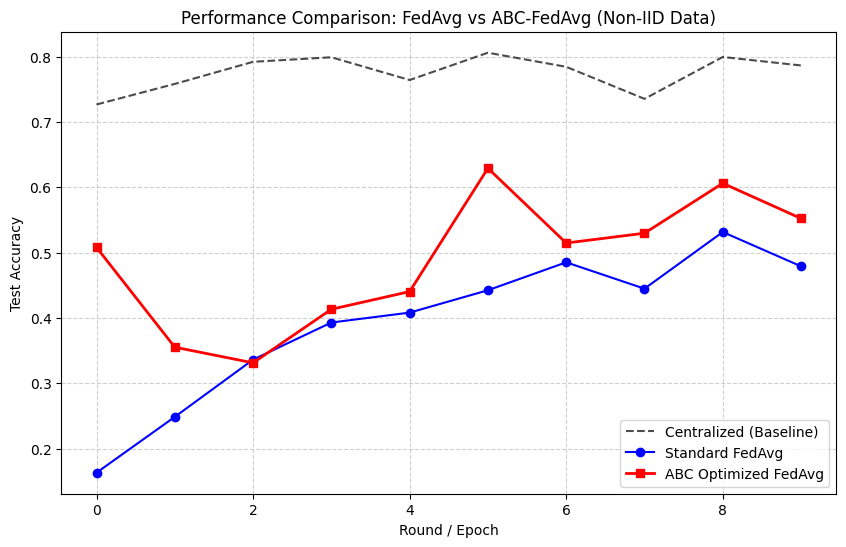
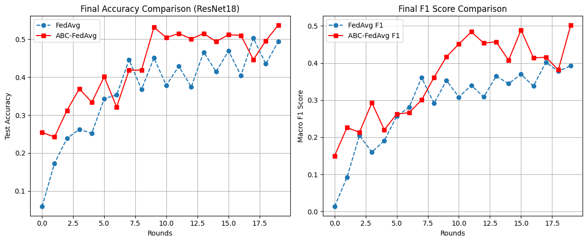

# 🐝 ABC-Optimized Federated Averaging on PathMNIST

**Learning how much to trust each client: Artificial Bee Colony (ABC) search for FedAvg aggregation weights under non-IID medical data.**


---

## 📌 Problem

In federated learning, hospitals train a shared model **without sharing patient data**. The standard aggregation rule, **FedAvg**, simply averages client models with fixed weights. When data is **non-IID** (each hospital sees a different mix of diseases), this fixed average pulls the global model in conflicting directions, and accuracy drops and fluctuates.

## 💡 Idea

Instead of a fixed average, treat the aggregation weights as an **optimization problem**. After every communication round, the server runs **ABC** to search for the client weights `w₁…w₅` that maximize accuracy on a small validation set, then aggregates with the normalized best weights:

```
θ_global = Σ (wᵢ / Σw) · θᵢ        wᵢ ∈ [0.1, 1.0]
```

The lower bound of 0.1 keeps every hospital contributing, so no client is silently dropped.

---

## 🧪 Experimental Setup

| | |
|---|---|
| **Dataset** | [PathMNIST](https://medmnist.com/) (MedMNIST v2): colon pathology, 9 tissue classes, 28×28 RGB |
| **Clients** | 5 simulated hospitals |
| **Non-IID split** | Training set sorted by label and cut into 5 contiguous shards, so each client sees only a narrow subset of classes (strong label skew) |
| **Scenarios** | ① Centralized (upper bound, no privacy) · ② Standard FedAvg · ③ ABC-optimized FedAvg |
| **Experiment A** | 2-layer CNN, 10 rounds, 1 local epoch, ABC: 5 food sources, 15 evaluations per round |
| **Experiment B** | ResNet-18 (adapted to 28×28), 20 rounds, 3 local epochs, data augmentation, ABC: 30 evaluations per round, accuracy + macro-F1 |

---

## 📊 Results

### Experiment A: SimpleCNN, 10 rounds

| Method | Final test accuracy | Best round |
|---|---|---|
| Centralized (upper bound) | 78.7% | 80.6% |
| Standard FedAvg | 47.9% | 53.2% |
| **ABC-FedAvg** | **55.2%** | **62.9%** |



### Experiment B: ResNet-18, 20 rounds

| Method | Final test accuracy | Final macro-F1 |
|---|---|---|
| Standard FedAvg | 49.3% | — |
| **ABC-FedAvg** | **53.7%** | **0.502** |

ABC-FedAvg led FedAvg in accuracy in 17 of 20 rounds and stayed ahead on macro-F1 for most of training, which matters because accuracy alone can hide classes the model ignores.



### Takeaways

- Learned aggregation weights consistently closed part of the gap between FedAvg and the centralized upper bound.
- The learned weights change from round to round, e.g. `[0.22, 0.04, 0.23, 0.25, 0.27]` in the last round of Experiment A, showing that the server learns to down-weight clients whose updates hurt the global model.
- A large gap to centralized training remains, which reflects how hard this label-skewed split is.

---

## 🚀 Run It

```bash
git clone https://github.com/yusufkorkmazyigit/fedLearningwithABC.git
cd fedLearningwithABC
pip install -r requirements.txt
jupyter notebook abc_optimized_fedAvg.ipynb
```

PathMNIST downloads automatically on first run. A GPU is recommended, especially for the ResNet-18 experiment (tested on Google Colab).

---

## ⚠️ Limitations & Next Steps

This is an exploratory study, and the following points are known limitations:

- **Validation data:** the 300 samples ABC uses to score weight combinations are taken from the test split. A cleaner protocol would carve the validation set out of training data (or from a server-side holdout) so the final test set stays untouched.
- **Single run:** results come from one seed. Federated training on non-IID data is noisy, so mean ± std over several seeds is the next step.
- **ABC variant:** the notebook uses a simplified ABC loop with a small evaluation budget for speed. The canonical implementation is available in [abc-optimizer-lib](https://github.com/yusufkorkmazyigit/abc-optimizer-lib).
- **Baselines:** comparing against FedProx, FedNova and loss-based weighting would place the method in the literature.
- **Cost:** each ABC evaluation runs inference on the validation set, which adds server-side computation per round.

---

## 🔗 Related

- [abc-optimizer-lib](https://github.com/yusufkorkmazyigit/abc-optimizer-lib): canonical ABC with a scikit-learn wrapper
- McMahan et al. (2017). *Communication-Efficient Learning of Deep Networks from Decentralized Data* (FedAvg)
- Karaboğa, D. (2005). *An Idea Based on Honey Bee Swarm for Numerical Optimization*, Erciyes University
- Yang et al. (2023). *MedMNIST v2: A Large-Scale Lightweight Benchmark for 2D and 3D Biomedical Image Classification*, Scientific Data

---

<sub>Developed by [Yusuf Korkmazyiğit](https://github.com/yusufkorkmazyigit), Computer Engineering, Erciyes University.</sub>
